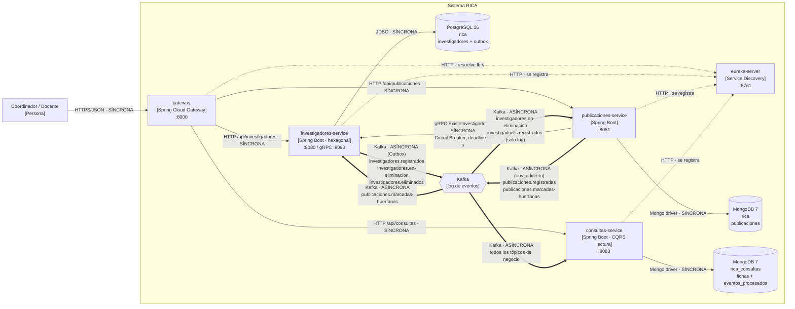

# Arquitectura de RICA (Red de Investigación y Control Académico)

> Este documento describe el sistema **tal como está construido** en la rama de este taller.
> Lo que no está implementado aparece marcado como **Propuesta** y nunca como si existiera.

## 1. Contexto y motivadores

RICA registra a los investigadores de la universidad y sus publicaciones académicas, y ofrece consultas
de lectura: la ficha de cada investigador con sus publicaciones, el ranking y las estadísticas. La usan los
coordinadores de investigación, que registran la información, y los docentes y directivos, que la consultan.
El sistema empezó como un monolito (`rica-api`) y hoy son tres servicios de negocio detrás de un gateway.

### Atributos de calidad prioritarios (en orden)

| # | Atributo | Escenario medible | ¿Se ha verificado? |
|---|---|---|---|
| 1 | **Integridad de los datos** | Si Kafka está caído cuando se registra un investigador, el registro se guarda igual y el evento `investigadores.registrados` se publica a más tardar unos 2 s después de que Kafka vuelva (el Outbox sondea cada 2 s). Ningún evento se pierde. | Sí, en investigadores-service. En publicaciones-service **no** se cumple (ver riesgo R1). |
| 2 | **Disponibilidad / aislamiento de fallos** | Si investigadores-service está caído, después de 5 llamadas con ≥ 50 % de fallos el circuito se abre y `POST /api/publicaciones` responde 503 sin esperar el deadline de 5 s. Mientras tanto, `GET /api/consultas/**` sigue respondiendo. | Sí, manualmente en el taller de comunicación (evidencia `circuit break.png`). |
| 3 | **Modificabilidad y testabilidad** | Un cambio en una regla de negocio (por ejemplo, el máximo de 5 publicaciones por año) se prueba con pruebas unitarias que no necesitan Kafka, PostgreSQL ni MongoDB, y el CI las corre en los 5 servicios en menos de 5 min por push. | Sí: CI de GitHub Actions corre las pruebas unitarias de los 5 servicios (FF-1). |
| 4 | **Rendimiento de consulta** | La ficha de un investigador con sus publicaciones se obtiene con una sola lectura por clave en MongoDB, sin joins ni llamadas a otros servicios. Objetivo: p95 < 300 ms con 50 usuarios simultáneos. | Parcial: la lectura única sí está implementada. La medición local dio un máximo de 182 ms en investigadores-service, pero **no hay prueba de carga** (riesgo R6). |
| 5 | **Observabilidad** | Ante una eliminación, el mismo `X-Correlation-Id` aparece en los logs de los tres servicios y el lag de cada grupo de consumidores se puede consultar. | Sí, en el taller de observabilidad (`evidencias/taller-observabilidad/`). |

### Restricciones

- Equipo pequeño de estudiantes, con un semestre de plazo y sin operación 24/7.
- Stack que el equipo domina: Java 25, Spring Boot 4, Spring Cloud y Maven.
- Infraestructura: Docker Desktop local (PostgreSQL 16, MongoDB 7, un broker de Kafka). No hay Kubernetes ni nube.
- CI en GitHub Actions. Solo `eureka-server` está empaquetado como imagen Docker.

## 2. Estilos y patrones por componente

| Componente | Estilo / patrón | Almacén de datos | Comunicación | Atributo que sirve | Problema concreto que resuelve |
|---|---|---|---|---|---|
| gateway (`:8000`) | API Gateway (Spring Cloud Gateway) | — | HTTP entrante; enruta con `lb://` vía Eureka | Modificabilidad (el cliente no conoce puertos internos) | Evita que el cliente sepa en qué puerto vive cada servicio. Es el punto donde iría la seguridad futura. |
| eureka-server (`:8761`) | Service Discovery | En memoria | HTTP (registro y latidos) | Modificabilidad | El gateway encuentra los servicios por nombre y no por `localhost:puerto`. |
| investigadores-service (`:8080`, gRPC `:9090`) | Microservicio + arquitectura hexagonal (dominio / aplicación / infraestructura) | PostgreSQL (`rica`), con migraciones Flyway | REST entrante; gRPC servidor; eventos vía Transactional Outbox; consume `publicaciones.marcadas-huerfanas` | Integridad (1), testabilidad (3) | El correo institucional debe ser único y el registro debe quedar atómicamente unido a su evento. |
| publicaciones-service (`:8081`) | Microservicio en capas, paquete por funcionalidad | MongoDB (`rica`) | REST entrante; cliente gRPC con Circuit Breaker; publica y consume en Kafka | Disponibilidad (2), modificabilidad (3) | Las publicaciones tienen campos distintos según el tipo (`detalles` como mapa). Si investigadores cae, se falla rápido en vez de colgar hilos. |
| consultas-service (`:8083`) | CQRS, lado de lectura (proyecciones) | MongoDB (`rica_consultas`, base propia) | Solo consume Kafka; REST de lectura | Rendimiento de consulta (4), disponibilidad (2) | La ficha necesita datos de dos servicios: armarla en cada petición exigiría dos llamadas síncronas. |
| Kafka (`:9092`) | Arquitectura dirigida por eventos (pub/sub) | Log de eventos | Publicar / suscribir | Integridad (1), disponibilidad (2) | Propaga hechos sin que el productor conozca ni espere a los consumidores. |
| Eliminación de investigador | Saga coreografiada | — | Eventos | Integridad (1) | Borrar un investigador exige marcar sus publicaciones en otra base sin una transacción distribuida. |
| Consumidores de consultas-service | Reintentos con espera exponencial + Dead Letter Topic + Idempotent Consumer | `eventos_procesados` en MongoDB | Kafka | Integridad (1) | Un mensaje venenoso no bloquea la partición y un duplicado no cuenta dos veces. |

### Prueba de necesidad y antipatrones revisados

- **Base de datos compartida:** no se da. Cada servicio tiene su propia base. Publicaciones y consultas comparten el *contenedor* de MongoDB, pero usan bases distintas y ninguno lee la del otro (riesgo R4).
- **Monolito distribuido:** la única cadena síncrona entre servicios es `gateway → publicaciones → investigadores` (dos saltos). Está protegida con un Circuit Breaker y un deadline de 5 s. Todo lo demás es asíncrono.
- **Estilo sin problema que lo justifique:** se evaluó una caché con Redis (taller 11) y se descartó: la ficha ya es una lectura por clave sobre una proyección, así que una caché solo añadiría invalidación.
- **Hexagonal "de nombre":** el dominio de investigadores todavía usa anotaciones `jakarta.persistence`, así que el hexagonal es parcial (deuda D1).

## 3. Diagrama de contenedores (C4, nivel 2)

Convención: línea continua = petición síncrona, línea gruesa = evento asíncrono, línea punteada = infraestructura (discovery).
Las dos bases de MongoDB viven en el mismo contenedor `publicaciones-mongo`.

### 3.1 Conexiones

| Origen → destino | Tecnología | Tipo | Por qué ese tipo |
|---|---|---|---|
| Cliente → gateway → servicios | HTTP/JSON | Síncrona | El cliente necesita la respuesta ya. |
| publicaciones → investigadores | gRPC `ExisteInvestigador` | Síncrona | Antes de guardar hay que saber si el investigador existe: es una consulta. |
| investigadores → consultas, publicaciones | Kafka | Asíncrona | Es la propagación de un hecho ("se registró", "se está eliminando"). |
| publicaciones → investigadores (Saga) | Kafka | Asíncrona | Es la confirmación de un paso de la Saga. |
| publicaciones → consultas | Kafka | Asíncrona | Alimenta la proyección de lectura. |
| servicios → eureka | HTTP | Síncrona (latidos) | Infraestructura de discovery. |

### 3.2 Eventos publicados

| Evento (tópico) | Productor | Consumidores | Datos | Mecanismo de publicación |
|---|---|---|---|---|
| `investigadores.registrados` | investigadores-service | consultas-service (proyección y, en otro grupo, estadísticas); publicaciones-service (solo lo registra en el log) | `id`, `correoInstitucional`, `nombreCompleto`, `correlationId` | Transactional Outbox |
| `investigadores.en-eliminacion` | investigadores-service | publicaciones-service, consultas-service | `correoInstitucional`, `correlationId` | Transactional Outbox |
| `publicaciones.marcadas-huerfanas` | publicaciones-service | investigadores-service | `correoInstitucional`, `cantidad`, `correlationId` | Envío directo (sin Outbox) |
| `investigadores.eliminados` | investigadores-service | consultas-service | `correoInstitucional`, `correlationId` | Transactional Outbox |
| `publicaciones.registradas` | publicaciones-service | consultas-service | `id`, `investigadorCorreo`, `titulo`, `tipo`, `anio` | Envío directo (sin Outbox) |
| `<tópico>.DLT` | Manejador de errores de consultas-service | Ninguno automático (revisión manual) | Mensaje original + cabeceras con la excepción | Spring Kafka `DeadLetterPublishingRecoverer` |

### 3.3 Capa anticorrupción

publicaciones-service no conoce el modelo de investigadores: define su propio puerto `VerificadorInvestigador`
(solo pregunta "¿existe este correo?") y su propia copia del contrato `.proto`. El adaptador
`VerificadorInvestigadorGrpc` traduce los errores de gRPC a `ServicioNoDisponibleException`. Si mañana la
verificación se hiciera con una réplica local alimentada por eventos, solo cambiaría ese adaptador.

## 4. Decisiones (ADR)

Cada ADR está en [docs/adr/](docs/adr/) y tiene contexto, decisión, alternativas descartadas y consecuencias.

| ADR | Decisión | Estado |
|---|---|---|
| [ADR-001](docs/adr/ADR-001-descomposicion-en-microservicios.md) | Descomponer el monolito `rica-api` en servicios por contexto acotado | Aceptada |
| [ADR-002](docs/adr/ADR-002-base-de-datos-por-servicio.md) | Una base de datos por servicio: PostgreSQL para investigadores, MongoDB para publicaciones | Aceptada |
| [ADR-003](docs/adr/ADR-003-grpc-con-circuit-breaker.md) | Verificar al investigador con gRPC síncrono protegido por un Circuit Breaker | Aceptada |
| [ADR-004](docs/adr/ADR-004-eventos-kafka-con-outbox.md) | Propagar hechos con eventos en Kafka publicados mediante Transactional Outbox | Aceptada |
| [ADR-005](docs/adr/ADR-005-saga-coreografiada-eliminacion.md) | Eliminar investigadores con una Saga coreografiada | Aceptada |
| [ADR-006](docs/adr/ADR-006-cqrs-consultas-service.md) | Separar las lecturas en consultas-service (CQRS) con consumidores robustos | Aceptada |
| [ADR-007](docs/adr/ADR-007-outbox-en-publicaciones.md) | Usar también Outbox en publicaciones-service | **Propuesta** |

## 5. Fitness functions

| # | Regla | Cómo se verifica | Cuándo se ejecuta | Estado |
|---|---|---|---|---|
| FF-1 | Las pruebas unitarias de los 5 servicios pasan, sin necesitar infraestructura. | Workflow [.github/workflows/ci.yml](.github/workflows/ci.yml): una matriz con un job por servicio ejecuta `mvnw test -Dtest='!*ApplicationTests'`. | En cada push y en cada Pull Request hacia `main`. | **Implementada** |
| FF-2 | Ningún servicio apunta a la base de datos de otro. | Paso de CI que extrae `spring.datasource.url` y `spring.mongodb.uri` de cada `application.yml` y falla si dos servicios declaran la misma base (por ejemplo, `mongodb://…/rica` en dos servicios). | En cada push, como un job adicional del CI. | Propuesta |
| FF-3 | El paquete `dominio` de investigadores-service no depende de `infraestructura` ni de `org.springframework`. | Prueba ArchUnit: `noClasses().that().resideInAPackage("..dominio..").should().dependOnClassesThat().resideInAnyPackage("..infraestructura..", "org.springframework..")`. Corre dentro de FF-1. | En cada push (es una prueba unitaria más). | Propuesta |
| FF-4 | No hay sagas atascadas: ningún investigador permanece más de 10 min en `EN_ELIMINACION`. | Gauge `rica.sagas.eliminacion.atascadas` expuesto por Actuator, con una alerta si es > 0 durante 1 min (diseñado en `evidencias/taller-observabilidad/5-discusion.md`). | Continuamente, en ejecución. | Propuesta |

## 6. Mesh: ¿lo necesitamos?

Respuestas a las preguntas de la guía:

- **¿Cuántos servicios?** 3 servicios de negocio, más gateway y Eureka: 5 procesos en total.
- **¿Requisitos uniformes de seguridad y resiliencia?** No. Solo hay una llamada síncrona entre servicios (publicaciones → investigadores) y su resiliencia se resuelve en código con Resilience4j.
- **¿Hay Kubernetes?** No. Todo corre con `mvnw spring-boot:run` y Docker Desktop local.
- **¿Cuántos dominios de datos y equipos?** 2 dominios de datos fuente (investigadores, publicaciones), más una proyección de lectura. Un solo equipo pequeño.

**Service mesh: no**, porque con una sola llamada síncrona entre servicios y sin Kubernetes, un sidecar por
servicio añadiría más procesos que operar que problemas resueltos. Usamos en su lugar Eureka para el
discovery, Resilience4j para el Circuit Breaker, deadlines de gRPC y `X-Correlation-Id` propagado en el
código para la trazabilidad. Lo reconsideraríamos con más de ~10 servicios, varios equipos y la necesidad
de mTLS entre todos.

**Data mesh: no**, porque hay un solo equipo y dos dominios de datos, sin consumidores analíticos
independientes. La necesidad de "datos como producto" se cubre con los eventos publicados (§3.2) y con
consultas-service como modelo de lectura.

## 7. Riesgos y deuda conocida

| # | Riesgo / deuda | Qué pasa si se materializa | Qué haríamos |
|---|---|---|---|
| R1 | publicaciones-service guarda en MongoDB y luego publica en Kafka por separado (escritura dual). | Si el proceso cae entre ambos pasos, se pierde `publicaciones.registradas` (la ficha queda sin esa publicación) o `publicaciones.marcadas-huerfanas` (la Saga queda atascada). | Implementar ADR-007 (Outbox en publicaciones). Mientras tanto, reprocesar a mano desde MongoDB. |
| R2 | La Saga de eliminación no tiene compensación ni alerta. | Si publicaciones falla de forma permanente, el investigador queda indefinidamente en `EN_ELIMINACION`. | Diseño ya escrito (taller 10): evento `publicaciones.marcado-huerfanas-fallido` y FF-4. |
| R3 | El gateway no tiene autenticación ni autorización, y las credenciales de las bases están en texto plano en `application.yml`. | Cualquiera con acceso a la red puede crear o eliminar investigadores. | Validación de JWT en el gateway y credenciales por variables de entorno (ya soportado por Spring Boot, taller 11). |
| R4 | Un solo broker de Kafka (`replicas(1)`) y un solo contenedor de MongoDB para dos servicios. | Si el broker cae, se detiene toda la propagación (el Outbox acumula, no pierde). Si MongoDB cae, se caen publicaciones y consultas a la vez. | Aceptable en el curso. En producción: 3 brokers con `min.insync.replicas=2` y una instancia de MongoDB por servicio. |
| R5 | El canal gRPC usa `static://localhost:9090` y `ProyectorFichas` usa `synchronized`. | No se puede escalar horizontalmente investigadores ni consultas: gRPC no balancea y la sincronización no protege entre instancias. | Resolver gRPC vía discovery y hacer las proyecciones idempotentes por versión en vez de por bloqueo. |
| R6 | No hay prueba de carga. El escenario de rendimiento (atributo 4) no está verificado. | Podríamos descubrir en producción que la ficha no cumple el p95. | Prueba con k6 o Gatling sobre `GET /api/consultas/investigadores/{correo}` como fitness function de CI. |
| D1 | El dominio de investigadores usa anotaciones JPA (`@Entity`, `@Embeddable`). | Cambiar la persistencia obliga a tocar el dominio. | Separar las entidades JPA en `infraestructura` con un mapper, y luego activar FF-3. |

## Nota de revisión cruzada

> Completar después de intercambiar el documento con otro grupo (paso 8 del taller).

- **Grupo revisor:** …
- **Comentarios recibidos:**
  1. …
- **Comentarios incorporados y cómo:** …
- **Comentarios no incorporados y por qué:** …
